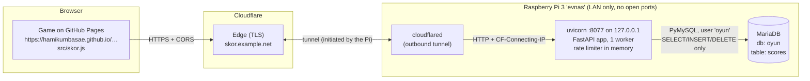

# skor-api

A small, self-hosted leaderboard service for my browser games. It runs on a Raspberry Pi 3 at home and is
reached from the internet through a Cloudflare Tunnel, without opening any ports.

- **Games:** [Bug Avcısı](https://hamikumbasae.github.io/bug-avcisi/) (platformer) and
  [Boğaz Yolu](https://hamikumbasae.github.io/bogaz-yolu/) (racing, two courses with separate boards).
  The game id is part of the URL, so adding a game is one entry in `app/games.py`.
- **Stack:** Python 3.13, FastAPI, PyMySQL (no ORM), MariaDB, uvicorn with 1 worker, systemd, cloudflared.
- **Footprint:** about 60 MB RSS. Install with one idempotent script (`deploy/kurulum.sh`).
- **Tests:** 52 pytest tests against a real MariaDB. There is also a Playwright end-to-end run that plays both
  games in Chromium (see "Testing").

> Kurulum ve Türkçe adım adım anlatım: **[DEPLOY.md](DEPLOY.md)**. Türkçe hızlı başlangıç aşağıda.

## Architecture



**Why a tunnel?** GitHub Pages serves the games over HTTPS, and browsers block requests from an HTTPS page to
`http://192.168.1.2` (mixed content). That address is not reachable from the internet anyway. Cloudflare Tunnel
gives the Pi a public HTTPS hostname. The Pi only makes *outgoing* connections, so the router needs no port
forwarding and the home IP stays hidden.

### Request flow

```mermaid
sequenceDiagram
  participant G as Game (browser)
  participant A as skor-api
  participant D as MariaDB
  G->>A: POST /v1/games/{game}/runs {mode}   (run starts, fire-and-forget)
  A-->>G: {token}  — HMAC-signed {game, mode, run_id, issued_at}; nothing stored
  Note over G: player plays…
  G->>A: POST /v1/games/{game}/scores {token, name, score, meta}
  A->>A: verify signature/age · validate name · plausibility(score, now − issued_at, meta)
  A->>D: INSERT (run_id UNIQUE → token is single-use)
  A-->>G: {rank, best, personal_best, week_rank}
  G->>A: GET /v1/games/{game}/scores?mode=&period=all|week&limit=10
  A-->>G: top N, best score per player
```

## API

Base URL is whatever the tunnel exposes (for example `https://skor.celikdovme.net`). All bodies are JSON.
Errors look like `{"detail": {"code": "name_blocked", "message": "…"}}`. The game maps `code` to Turkish text.
Interactive docs are served at `/docs`.

| Method | Path | Body / query | Returns | Rate limit (per IP) |
|---|---|---|---|---|
| GET | `/health` | | `{status, db, version}` (503 if the DB is down) | none |
| GET | `/v1/games` | | games and their modes | read |
| POST | `/v1/games/{game}/runs` | `{mode?}` | `201 {token, mode, expires_in}` | 20/min |
| POST | `/v1/games/{game}/scores` | `{token, name, score, meta}` | `201 {id, name, mode, score, best, personal_best, rank, week_rank}` | 6/min and 150/day |
| GET | `/v1/games/{game}/scores` | `mode`, `period=all\|week`, `limit≤50` (default 10) | `{entries: [{rank, name, score, at}]}`, one entry per player | read (60 burst, 1/s) |
| GET | `/v1/games/{game}/players/{name}` | `mode` | `{name, best, rank, runs, best_at, week_best}` | read |

Games and modes: `bug-avcisi` (`normal`), and `bogaz-yolu` (`bogaz` for Boğaz Yolu, `tur` for İstanbul Turu).

Error codes: `unknown_game` 404 · `unknown_mode` 400 · `token_invalid` 403 · `token_expired` 410 ·
`token_used` 409 · `name_short|name_long|name_chars|name_blocked` 422 · `too_fast|score_implausible|meta_invalid`
422 · `rate_limited` 429 (+`Retry-After`) · `db_unavailable` 503.

"This week" starts on Monday at 00:00 Istanbul time (UTC+3 all year). Players are grouped by a Turkish-aware
lowercase key, so `HAMİ` and `hami` count as one player, while `IŞIK` and `İŞİK` are two different players.

## Anti-cheat design

A browser game runs entirely on the player's machine. Anyone can open DevTools, change the score variable, or
replay the requests. **No client-side game can be made cheat-proof**, and this service does not claim to be.
The goal is proportionate: stop drive-by `curl` spam, keep obviously impossible scores out, and keep the
board fun. Layers, from cheapest to most specific:

1. **CORS** allows only `https://hamikumbasae.github.io` and `localhost`/`127.0.0.1` on any port (local dev
   and the Android build of Bug Avcısı). This stops other websites from posting through visitors' browsers. It
   does not stop scripts, because CORS is a browser feature.
2. **Signed run token.** The client must fetch a token when the run *starts*. The token is an HMAC-SHA256 over
   `{game, mode, run_id, issued_at}` with a server secret. It is stateless, so issuing one writes nothing, and it
   is valid for 12 h. `run_id` is `UNIQUE` in the table, so each token can be submitted once.
   - A token is bound to its game: a Boğaz Yolu token cannot submit a Bug Avcısı score.
   - The server measures the run's **real duration** as `now − issued_at`. Every time-based check uses this
     value, never a duration the client claims.
3. **Per-IP rate limits** (token bucket, in memory). Behind the tunnel, the peer is `127.0.0.1`, so the client
   IP is read from `CF-Connecting-IP`. Forwarded headers are trusted *only* when the peer is loopback.
   The IP itself is never stored; only a keyed 64-bit hash is kept, for moderation.
4. **Name rules.** 2–16 characters (letters including Turkish ones, digits, space, `. _ -`) with at least one
   letter. The profanity filter is deliberately light. Short roots match only as whole words, because naive
   substring matching would block real Turkish words and names: `Işık` folds to `isik`, which contains `sik`.
   The input is folded (Turkish lowercase, diacritics, leetspeak digits, repeated letters) before matching.
   Tests cover both blocked and allowed names (`Işık`, `Sıkıdost`, `Nigar`, `Musiki`…).
5. **Per-game plausibility**, with limits derived from each game's source code:

   **Bug Avcısı** (`src/core.js`, `src/levels.js`)
   - Every score increment in the game is a multiple of 50, so `score % 50 ≠ 0` is rejected.
   - There are 36 stages. Lives are infinite and dying reloads the stage, coins included, so the score is
     *not* bounded per stage: a patient player can farm. A static upper bound per stage (every coin, block,
     enemy in a perfect combo chain, gold simit, memory piece, top antenna bonus, full time bonus, boss) is
     28k–76k. The rule is `score ≤ 80,000 × (cleared + 1) + 600 × seconds`, capped at 3,000,000.
   - Running a stage's length at top speed (9.6 tiles/s) takes 12–23 s. The rule requires at least
     10 s per cleared stage.
   - `meta = {start, cleared, finished}` must be consistent: `start + cleared ≤ 36`, and `finished` means the
     run reached the end.

   **Boğaz Yolu** (`src/core.js`, `src/track.js`)
   - Distance points are `round(speed/MAX · dt · 1500)` per frame, which adds up to exactly
     `1500 × distance / MAX` and is never more than 1500 per second. The finish bonus is `2000 × seconds left`.
   - I enumerated every route and computed the exact maximum (top speed the whole way, no crashes, rain time
     extensions). Boğaz Yolu (8 routes): **566,758**, fastest possible finish 252.6 s. İstanbul Turu:
     **690,683**, fastest finish 330.6 s. The game's own test bot scores 450k–515k and 563k–597k.
   - Rules: `score ≤ 1500 × seconds × 1.02 (+ 2000 × max time left, if finished)`, capped at 600k / 730k.
     A finished run must take at least 240 s / 315 s.

**What still gets through:** someone who reads `skor.js` can request a token, wait the right amount of time,
and submit a made-up score that stays under the limits. Fixing that needs server-side simulation (sending
inputs and replaying them deterministically). Bug Avcısı's core is deterministic and runs in Node, so that
would be possible, but it is out of proportion for a hobby board. The practical remedy is moderation:
`DELETE FROM scores WHERE …` (see DEPLOY.md).

## Trade-offs

| Decision | Why | Cost |
|---|---|---|
| PyMySQL, no ORM | One table and five queries. Fewer dependencies and less RAM on a Pi 3. | Hand-written SQL (parameterized everywhere). |
| One uvicorn worker | Enough for a hobby game, and the in-memory rate limiter stays consistent. | Not horizontally scalable. Limits reset on restart. |
| Stateless HMAC tokens | Starting a run writes nothing, so unfinished runs leave no garbage. | A token can't be revoked before it expires (12 h). It is single-use only once submitted. |
| Store every submission; show best per player | Full history for moderation. `ROW_NUMBER()` window query picks the best per player. | The table grows slowly (a few bytes per run). Fine for years at hobby scale. |
| Cloudflare Tunnel | HTTPS without port forwarding, home IP hidden, free. | Depends on Cloudflare. The quick-tunnel URL changes on restart, so production needs a domain on Cloudflare DNS. |
| Leaderboard off by default in the games | An empty `SKOR_API` keeps the games exactly as before. The local high score is untouched. | One manual step: put the URL in `src/skor.js`. |
| Short client timeouts (5 s), fire-and-forget token | The game never waits on the network. | If the server is down when a run starts, that run's score can't be submitted. The player sees a friendly message. |

## Running locally

```bash
cd skor-api
python3 -m venv .venv && . .venv/bin/activate
pip install -r requirements-dev.txt

# MariaDB: database + user (the tests use a separate database, oyun_test, which they wipe)
sudo mariadb -e "CREATE DATABASE oyun_test; CREATE USER 'oyun'@'localhost' IDENTIFIED BY 'yerel-test-sifresi';
                 GRANT ALL ON oyun_test.* TO 'oyun'@'localhost';"
pytest                       # 52 tests

# run against database 'oyun' (schema.sql applied)
export SKOR_SECRET=$(openssl rand -hex 32) SKOR_DB_PASSWORD=… SKOR_DB_NAME=oyun
uvicorn --factory app.main:create_app --host 127.0.0.1 --port 8077 --workers 1
```

To try a game against it without editing the code, serve the game (`python3 -m http.server`). Then set
`window.SKOR_API = 'http://127.0.0.1:8077'` before `src/skor.js` loads, for example with Playwright's
`addInitScript`. Or put the URL in the `SKOR_API` constant at the top of `src/skor.js`.

## Testing

- `pytest`: API, tokens (tampering, expiry, wrong game, reuse), name filter, plausibility rules for both games,
  week boundary in Istanbul time, CORS, per-IP limits behind a proxy, DB-down → 503.
- End to end (Playwright + Chromium, real API + real MariaDB, both games served locally):
  - leaderboard **off**: no button, no network requests, the local high score is still saved;
  - **on**: the game's own game-over flow asks for a name, the score appears in the top 10, and the week tab works;
  - typing `Z` or space in the name field doesn't trigger the game;
  - the Bug Avcısı finale submits automatically after the last stage;
  - the Boğaz Yolu course tabs work, and the local arcade high-score screen still works first;
  - **server unreachable**: the game keeps running, and the player sees a friendly message;
  - phone viewport: no overflow.
- Each game's own Node test suites still pass.

## Adding a game

1. Add an entry to `GAMES` in `app/games.py`: id, title, modes, and a `check(mode, score, elapsed, meta)` that
   raises `Implausible` on impossible scores.
2. Copy `src/skor.js` into the game and change the three lines in its `AYAR` block (`OYUN`, `MODLAR`, colors).
3. Call `OYUN_SKOR.runStart(mode)` when a run starts and `OYUN_SKOR.runEnd({score, meta})` when it ends.

---

## Türkçe hızlı başlangıç

Raspberry Pi'de (evnas), depo klasöründe:

```bash
git clone https://github.com/hamiKumbasae/bug-avcisi.git && cd bug-avcisi
sudo bash skor-api/deploy/kurulum.sh          # venv, bağımlılıklar, 'oyun' veritabanı, servis
curl http://127.0.0.1:8077/health              # {"status":"ok","db":true,...}
```

Sonra API'yi Cloudflare Tunnel ile HTTPS üzerinden dışarı aç (modeme port yönlendirme **yapma**). Ardından iki
oyunda `src/skor.js` dosyasının başındaki `SKOR_API` sabitine adresi yaz, ör. `'https://skor.celikdovme.net'`.
Adres boşken oyunlar eskisi gibi çalışır. Ayrıntılar, tünel seçenekleri ve bakım: **[DEPLOY.md](DEPLOY.md)**.
